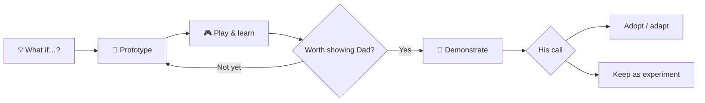
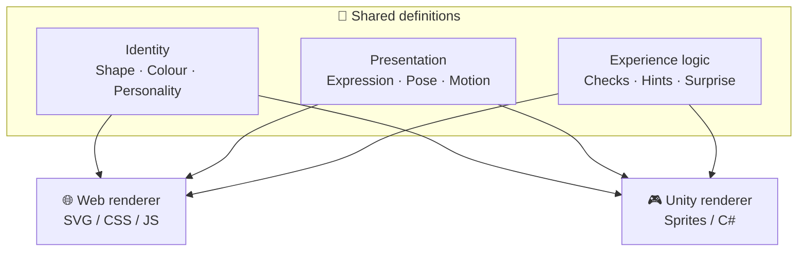

# 🧪 ひみつの実験室 · Secret Lab

**A little laboratory for ideas Dad hasn't approved yet.**

> お父さんのペントミノに、ちょっとした「もしも」を。  
> まず作って、遊んで、考える。採用されるかどうかは、また別の話。😏

[Visit the laboratory](https://chichacha.github.io/psychic-pento-guacamole/experimental/) · [Browse experiments](#experiments) · [Design principles](#design-principles)

> [!NOTE]
> This is an **open, unofficial prototyping space** for exploring possible improvements to Dad's Unity pentomino app. It is **not** an approved roadmap or a commitment to change the original app. The repository is public; “secret” is part of the joke.

## How this lab differs from the other sections

| Section | What visitors come to do | Editorial voice |
| --- | --- | --- |
| [📖 おはなし](../stories/README.md) | Enjoy character stories, the census, and 五マス新聞 | Playfully sensational; never invent real statistics |
| [🔍 五マス研究室](../research/README.md) | Investigate and explain puzzle patterns | Factual, reproducible, transparent |
| **🧪 ひみつの実験室** | Try animations, interactions, and possible app features | Curious, hands-on, iterative |

**研究室が発見する。新聞社が大騒ぎする。実験室が作ってみる。** 😆

An experiment is not a validated research finding or an approved feature. The three sections can share data and ideas without sharing the same editorial voice.

## Why it exists

Dad built the puzzles and the Unity mobile app. Here we can test small, playful alternatives **before** asking him to consider them. A prototype might be adopted, modified, or rejected. All three outcomes are useful.

**Prototype first. Negotiate later.** 😆

## How experiments work

## Design principles

### 1. Build systems, not one-off assets

Prefer reusable character kits, composition rules, and data-driven variations over dozens of hardcoded images or screens.

### 2. Separate identity, presentation, and experience logic

The diagram is a **design goal**, not an existing implementation. Share structured data and specifications where practical; implement platform-specific rendering and interactions separately.

### 3. Design for localization

Keep text separate from illustrations. Use translation strings and flexible layouts rather than creating a separate decorative image for each language, difficulty, or level.

### 4. Make room for delight

Use combinations of expressions, movements, messages, and small surprises. Celebrate every solved puzzle, including those solved with hints.

### 5. Prove reuse with one small experiment

Start with **one character, three expressions, and one animation**. Test on the web; validate Unity compatibility before expanding to all 12 characters.

🔧 Technical notes: what is actually reusable?

| Shared across platforms | Platform-specific |
| --- | --- |
| Shape coordinates and colour tokens | SVG rendering vs Unity sprites |
| Character names and dialogue data | Typography and layout implementation |
| Expression and animation *definitions* | CSS/JS vs C#/Animator execution |
| Celebration rules and event schemas | Integration with each app |

SVG is useful as a source format, but Unity import compatibility needs testing. A common specification does **not** guarantee identical rendering or animation behaviour.

## Experiments

| Experiment | Stage | Goal |
| --- | --- | --- |
| [#30 — Celebration kit](https://github.com/chichacha/psychic-pento-guacamole/issues/30) | 💡 Idea | Surprise and delight using reusable, localized components |
| [#31 — Lab entrance](https://github.com/chichacha/psychic-pento-guacamole/issues/31) | 💡 Idea | Explain the purpose of this laboratory on `experimental/index.qmd` |

Stages are informal: **💡 Idea → 🧪 Prototyping → 👀 Ready to show → 🎉 Adopted**, or **📦 Archived**. The table should reflect actual progress, not planned outcomes.

## Working agreement

- [ ] Understand the problem before building
- [ ] Keep experiments separate from Dad's production app
- [ ] Reuse data and components where practical
- [ ] Make a small playable demonstration
- [ ] Record what worked, what failed, and what surprised us
- [ ] Ask Dad what he thinks — without assuming approval

> [!TIP]
> A successful experiment does not have to become a production feature. Learning something useful counts.

🤫 The not-so-secret mission

Build something so interesting that Dad eventually says:

「……まあ、こっちの方がいいかもね。」

No guarantees. 😂

---

*Simplicity is the output of understanding complexity—not the absence of it.*
