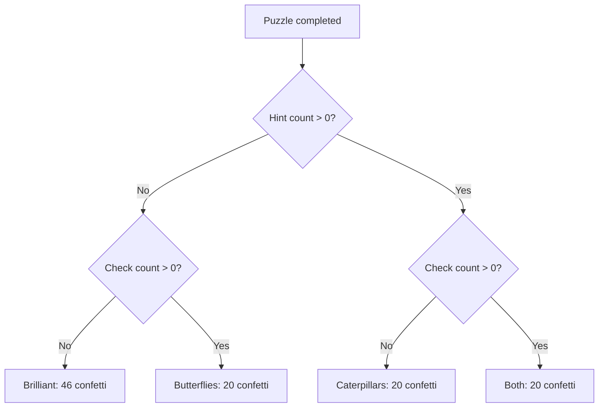

# 🎉 Gomasu Celebration — Unity Handoff

**Status:** Reference package for a Unity prototype, not production-ready Unity code  
**Source:** [Gomasu Studio celebration experiment](https://chichacha.github.io/psychic-pento-guacamole/experimental/celebration/)  
**Tracking:** [Issue #68](https://github.com/chichacha/psychic-pento-guacamole/issues/68)

## お父さんへ

これは「お祝いシーン」の **見た目と動き、そして条件分岐** を Unity で再現するための参考資料です。JavaScript や CSS を Unity にそのまま移すのではなく、Claude と一緒に C# / Unity UI / Particle System で作り直してください。パズルの判定・保存機能は変更しないでください。

## What to recreate

Every completed puzzle deserves a celebration. Hints and checks change the *personality* of the celebration, not whether the player deserves congratulations.

| Hints | Checks | Message (JA) | Scene |
| --- | --- | --- | --- |
| 0 | 0 | ひらめいた！ | 46 confetti pieces, no caterpillars/butterflies |
| >0 | 0 | 助けてもらって、できた！ | 20 confetti pieces + ground caterpillars |
| 0 | >0 | たしかめながら、できた！ | 20 confetti pieces + butterflies |
| >0 | >0 | じっくり、できた！ | 20 confetti pieces + both |

These are the documented values for the current web experiment; verify against packaged source before implementation. Display up to five caterpillars and five butterflies. Character identity is the last successfully placed pentomino. Level changes the confetti shape variety: 1–3 squares; 4–6 squares/circles; 7–8 add diamonds; 9–10 add candy shapes. Colors come from the 12-character palette. Particles settle around the middle of the scene and stay visible; keep the character's face readable.

## Package manifest

Copy these files from the **same repository commit**, preserving their relative paths:

```text
experimental/celebration/index.qmd
experimental/celebration/README.md
experimental/celebration/how-it-works.qmd
assets/js/celebration.js
assets/css/celebration.css
data/celebration.json
data/characters.json
assets/svg/caterpillar.svg
assets/svg/butterfly.svg
```

Check the live source for any additional dependencies before finalizing the ZIP. The JavaScript currently generates candy and butterfly SVG inline; the external butterfly asset may not control the displayed butterfly. Include a screenshot or recording of the browser scene, and optionally a standalone rendered HTML demo with its dependencies. The `.qmd` file requires Quarto to render; it is **not** a standalone HTML file.

**Package version:** TBD  
**Source commit SHA:** TBD  
**Verified file manifest:** Pending  
**Unity version / UI framework:** To be determined by Dad

## Behavioral interface (illustrative, not Dad's save schema)

```json
{
  "mode": "white_belt",
  "puzzleId": "example",
  "level": 5,
  "lastPlacedPiece": "F",
  "hintCount": 2,
  "checkCount": 1
}
```

Confirm the actual mode identifiers, counter reset semantics, last-piece tracking and puzzle-completion event with the Unity code. The web page uses manual simulator controls, not game save data.

## Unity architecture suggestion

1. **Completion adapter:** Read the game's existing completion event and map values to a small celebration input object; do not alter puzzle validation or saved state.
2. **Rules:** A testable C# function chooses the message key and prop/confetti counts based on Hint × Check and level.
3. **Content:** Load localized phrases and canonical character colors separately from the rules.
4. **Presentation:** Use Unity UI, animation and/or particles to recreate character, candy/confetti, caterpillars and butterflies. Recreate layering, movement, settling and replay behavior.
5. **Testing:** Exercise all four Hint × Check combinations, all 12 characters, levels 1–10, Japanese/English fallback, small screens and repeated celebrations.

### Rules diagram



## Suggested prompt for Claude Code

> Inspect the existing Unity project before making changes. Treat this ZIP and the live Gomasu celebration page as **behavioral and visual references**, not directly portable Unity code. Propose a small, isolated C# implementation with separate input adapter, pure celebration rules, localized data and presentation. Preserve puzzle completion logic and existing saved states. Identify any missing assets or assumptions, then build one reversible prototype and test all four Hint × Check outcomes. Do not refactor unrelated game code.

## Boundaries and ownership

This is a family collaboration handoff, **not** a blanket license for redistribution, merchandising, or publication of Gomasu characters. Confirm repository and asset licensing before sharing outside the intended collaborators.

## Before sending

- [ ] Copy all required source files and transitive assets from one commit
- [ ] Record commit SHA and version above
- [ ] Include reference screenshots/video
- [ ] Extract the ZIP and verify manifest paths
- [ ] Confirm Dad can open the files in Claude and see the live demo

**ひみつの実験室より。まず作る。あとで相談。** 🥑
