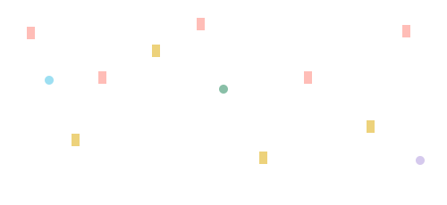
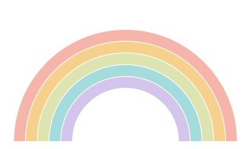
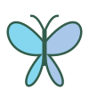
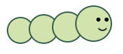
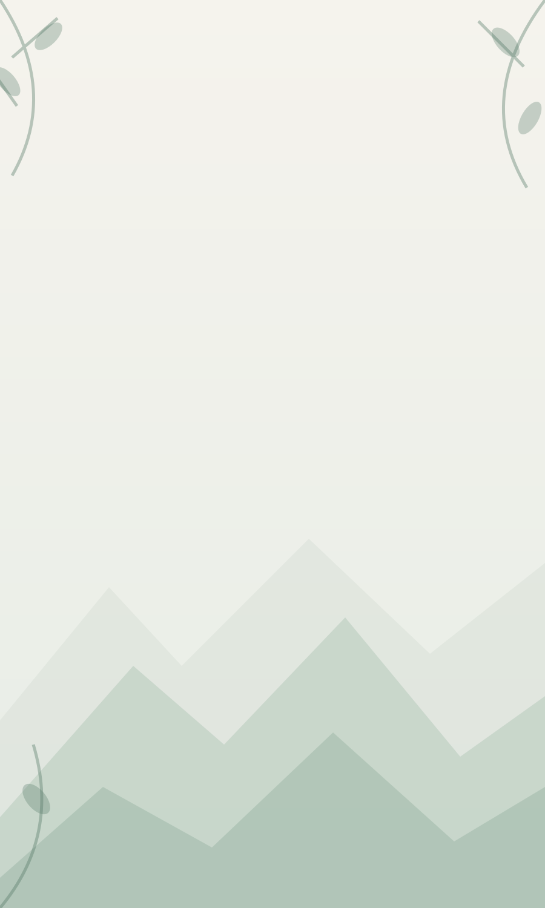
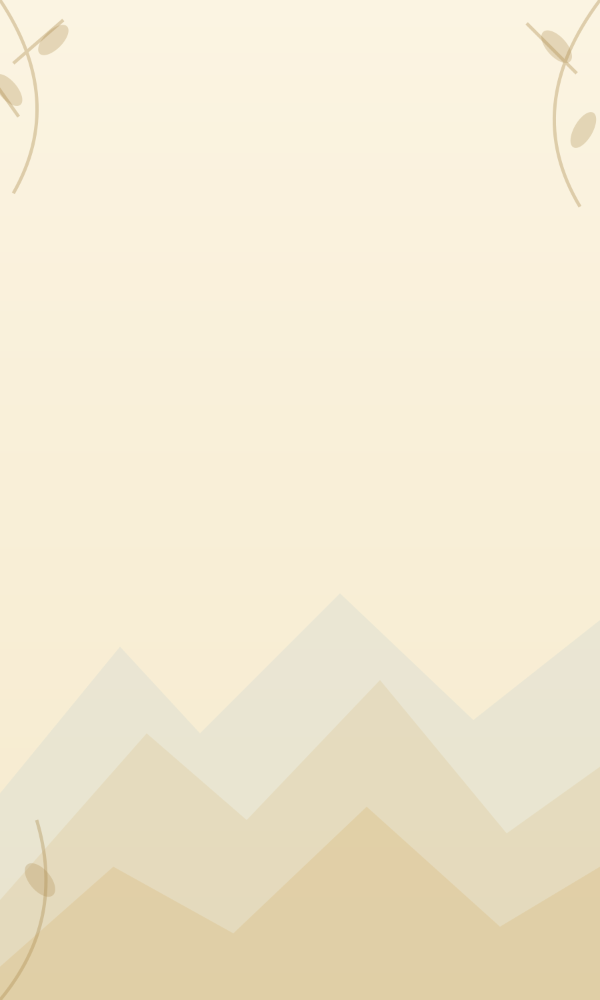

::: {.design-lab}

🧪 ひみつの実験室 · #81
<h1>Gomasu UI Design Kit</h1>
Same layout. Calmer look. More delightful details. Dad’s original 12 piece colours stay unchanged.

<label>Device <select id="device"><option value="tablet" selected>Tablet</option><option value="phone">Phone</option><option value="fluid">Fluid width</option></select></label>
<label>Orientation <select id="orientation"><option value="portrait" selected>Portrait</option><option value="landscape">Landscape</option></select></label>
<label>Belt <select id="belt"><option value="black" selected>黒帯</option><option value="white">白帯</option><option value="yellow">黄帯</option></select></label>
<label>Language <select id="language"><option value="en" selected>English</option><option value="ja">日本語</option></select></label>
<label>Appearance <select id="appearance"><option value="facelift" selected>Facelift</option><option value="original">Approx. original</option></select></label>
<label>Puzzle state <select id="puzzle-state"><option value="playing" selected>In progress</option><option value="completed">Just completed</option><option value="revisit">Revisit completed</option></select></label>
<label><input type="checkbox" id="used-hint"> Used hint</label><label><input type="checkbox" id="used-check"> Used check</label>

<main class="game" id="game">
<header class="game-top"><button class="settings" aria-label="Settings"></button>
Pentomino 6×10
</header>

<button class="action check" id="check-btn">Check</button><button class="action hint" id="hint-btn">Hint</button><button class="nav" aria-label="Previous puzzle"></button><button class="nav" aria-label="Next puzzle"></button>黒帯

<output id="check-count">0</output><output id="hint-count">0</output>0672Level 6

よくできました！

</main>

Visual prototype only. The example board follows the supplied screenshot’s horizontal 10×6 orientation and partial placement; this is not a playable puzzle engine. The celebration replaces only the lower piece tray, never the board or controls.

<section class="asset-guide"><h2>Asset library</h2>
All backgrounds, icons, pieces and celebration illustrations are standalone SVGs in <code>assets/</code>. The mountain motifs are original editable vector interpretations of the design-board concept, not traced artwork.

</section>
:::
